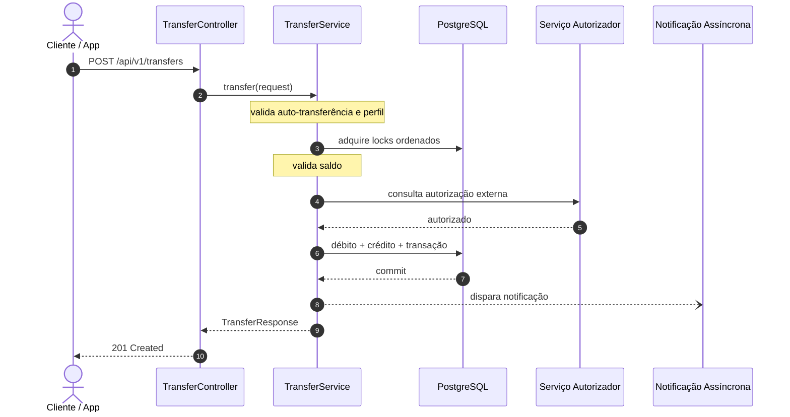

# 💳 PayFlow API — Digital Wallet & Transaction Engine

[](https://openjdk.org/projects/jdk/21/)
[](https://spring.io/projects/spring-boot)
[](https://www.postgresql.org/)
[](https://www.docker.com/)
[](https://opensource.org/licenses/MIT)

> **PayFlow API** é um projeto de estudo de carteira digital para explorar regras de negócio de transferências e sua tradução em uma solução de tecnologia. Complementa meu portfólio para **Analista de Negócios**, com foco em restrições por perfil, saldo, autorização e cenários de exceção.

---

## 💼 Problema de negócio

Sistemas de pagamentos precisam garantir que uma transferência respeite regras de perfil, saldo, autorização e consistência mesmo quando várias operações acontecem ao mesmo tempo ou quando serviços externos falham.

O objetivo deste projeto é transformar esse problema em uma API verificável e tecnicamente defensável.

---

## Análise de Negócios aplicada ao projeto

| Necessidade do negócio | Regra ou comportamento documentado | Discussão de validação |
|---|---|---|
| Respeitar permissões de cada perfil | Lojistas não enviam transferências | Conferir tentativa de envio por lojista |
| Preservar o saldo disponível | Recusar transferência sem saldo suficiente | Comparar valor solicitado e saldo |
| Evitar operações incoerentes | Impedir transferência para a própria carteira | Conferir pagador e recebedor iguais |
| Respeitar autorização externa | Condicionar a transferência à autorização | Avaliar recusa e indisponibilidade |
| Manter consistência financeira | Atualizar débito, crédito e registro da operação | Discutir falhas e operações simultâneas |

Esta leitura organiza o escopo descrito no projeto; não representa homologação com usuários de negócio. Idempotência, autenticação e testes específicos de concorrência permanecem entre as evoluções propostas abaixo. O estudo não representa uma solução bancária em produção.

## 🎯 Implementação de apoio

- 🔒 **Concorrência e prevenção de deadlocks** com *Pessimistic Write Lock* (`@Lock(LockModeType.PESSIMISTIC_WRITE)`) e ordenação determinística de carteiras.
- 📐 **Separação de responsabilidades** entre domínio, serviços, repositórios e DTOs com Java Records.
- 🚦 **Regras de negócio financeiras** para usuários `COMMON` e `MERCHANT`, saldo e transferências.
- 🌐 **Tratamento padronizado de erros** com RFC 7807 / `ProblemDetail`.
- ⚡ **Notificações assíncronas** via `@Async` e `ThreadPoolTaskExecutor`.
- 🛡️ **Integração resiliente** com serviço autorizador externo via `RestClient`.
- 📦 **Versionamento de banco** com Flyway.
- 🐳 **Execução containerizada** com Docker e Docker Compose.
- 🧪 **Testes unitários e de integração** com JUnit 5, Mockito, AssertJ e MockMvc.

---

## 🔄 Fluxo de transferência



---

## 🧠 Decisões técnicas importantes

### Lock pessimista

Uma transferência concorrente pode tentar alterar duas carteiras simultaneamente. O projeto utiliza lock pessimista para reduzir o risco de inconsistência durante a atualização de saldo.

### Ordem determinística das carteiras

As carteiras são bloqueadas em ordem previsível para reduzir risco de deadlock quando transações concorrentes envolvem os mesmos participantes em ordem inversa.

### Serviço autorizador externo

A autorização é tratada como dependência externa e, portanto, como possível ponto de falha. O fluxo separa regra local, integração e persistência para facilitar diagnóstico e evolução.

### Notificação fora do caminho crítico

A notificação é executada de forma assíncrona para não tornar uma dependência secundária parte desnecessária do tempo de resposta principal da transferência.

---

## 💬 Como explicar em entrevista

> "No PayFlow procurei tratar uma transferência como um problema de consistência de negócio, não apenas como um CRUD. O ponto mais importante foi pensar em concorrência, ordem de locks, regras por perfil, falhas externas e testes. Isso me permite discutir não só código, mas também trade-offs e riscos de uma operação financeira."

Perguntas que este projeto permite discutir:

- Por que usar lock pessimista neste cenário?
- Como reduzir risco de deadlock?
- Onde entraria idempotência?
- Como impedir transferência duplicada por retry do cliente?
- O que acontece quando o autorizador externo fica indisponível?
- Como evoluir notificações para mensageria?
- Como observar falhas e latência em produção?

📘 [Playbook de investigação de falhas](SUPPORT-PLAYBOOK.md)

---

## 🛠️ Tecnologias utilizadas

- **Java 21**
- **Spring Boot 3.3.4**
- **Spring Data JPA / Hibernate**
- **PostgreSQL 16**
- **H2** para testes e desenvolvimento
- **Flyway**
- **SpringDoc OpenAPI / Swagger UI**
- **Jakarta Bean Validation**
- **JUnit 5, Mockito, AssertJ e MockMvc**
- **Docker e Docker Compose**

---

## 🚀 Como executar

### Pré-requisitos

- Java 21
- Maven 3.9+
- Docker e Docker Compose (opcional)

### Ambiente local com H2

```bash
mvn clean test
mvn spring-boot:run
```

API: `http://localhost:8080`  
Swagger: `http://localhost:8080/swagger-ui.html`  
H2 Console: `http://localhost:8080/h2-console`

### Ambiente com PostgreSQL

```bash
docker compose up --build -d
```

API: `http://localhost:8080`  
pgAdmin: `http://localhost:5050`

---

## 📖 Endpoints

### Usuários — `/api/v1/users`

| Método | Endpoint | Descrição |
|---|---|---|
| `POST` | `/api/v1/users` | Cadastra usuário e provisiona carteira |
| `GET` | `/api/v1/users/{id}` | Busca usuário por ID |
| `GET` | `/api/v1/users` | Lista usuários |

### Transferências — `/api/v1/transfers`

| Método | Endpoint | Descrição |
|---|---|---|
| `POST` | `/api/v1/transfers` | Executa transferência entre carteiras |

Exemplo:

```json
{
  "payerId": 1,
  "payeeId": 2,
  "value": 150.00
}
```

### Carteiras — `/api/v1/wallets`

| Método | Endpoint | Descrição |
|---|---|---|
| `GET` | `/api/v1/wallets/users/{userId}` | Consulta carteira |
| `POST` | `/api/v1/wallets/deposit` | Realiza depósito |
| `GET` | `/api/v1/wallets/users/{userId}/statement` | Consulta extrato |

---

## 🧪 Testes automatizados

```bash
mvn test
```

Cenários cobertos incluem:

- transferência bem-sucedida;
- lojista impedido de enviar valores;
- bloqueio de auto-transferência;
- saldo insuficiente;
- recusa do autorizador externo;
- validação de requisições via MockMvc.

---

## 🔭 Próximas evoluções

As próximas melhorias de maior valor seriam:

1. idempotency key para transferências;
2. testes específicos de concorrência;
3. observabilidade com métricas e tracing;
4. autenticação/autorização;
5. eventos de domínio ou mensageria para notificações;
6. pipeline CI completo.

---

## 👨‍💻 Autor

**Daniel Fernando Martins**  
[LinkedIn](https://www.linkedin.com/in/danielfernandomartins) · [GitHub](https://github.com/danielfernandomartins) · [E-mail](mailto:dfernandom@outlook.com)

---

## 📄 Licença

Distribuído sob a licença [MIT](LICENSE).
